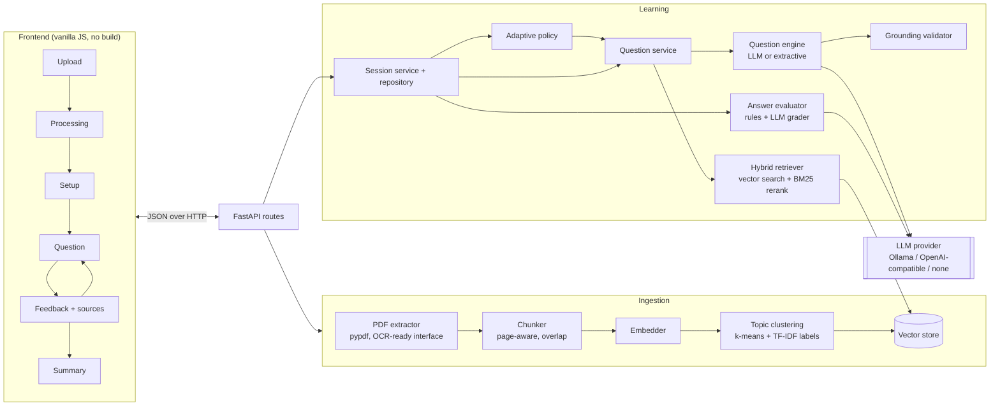

# DocTutor

Study any PDF one question at a time. DocTutor indexes your document, retrieves the passages a question should be about, writes a question grounded in those passages, grades your answer against the document, and shows you the exact page and sentence the answer comes from. The next question adapts to how you are doing.

It runs fully locally with a local LLM through [Ollama](https://ollama.com), can use Google's free Gemini API, works with any OpenAI-compatible server, and with no LLM at all it still runs using a deterministic question builder that works straight from document sentences.

## Features

- **Real RAG pipeline**: PDF → page-aware chunking → embeddings → vector index → hybrid retrieval (dense + BM25 rerank) → context-only generation. The whole PDF is never sent to the model.
- **Six question types**: multiple choice, true/false, fill in the blank, short answer, conceptual, and calculation (only offered for passages that contain numbers).
- **Grounding safeguards**: structured JSON output, a verbatim evidence quote that must be found in the retrieved context, per-type answer checks, and automatic regeneration when a draft fails. When a passage can't support a question, the model can say so instead of inventing one.
- **Semantic grading**: objective types are graded deterministically (letters, typos and casing tolerated); free-form answers are graded as correct / partially correct / incorrect against key points from the document, with what was missing or wrong.
- **Page-level sources**: every question carries chunk ids and page numbers; feedback shows the source passage with the evidence highlighted.
- **Explainable adaptation**: difficulty, topic and question type follow fixed rules, and the UI tells you why each question was chosen.
- **Session summary**: score, results by topic / type / difficulty, the difficulty path, weak topics and the pages to re-read.
- **No waiting between questions**: the next question is written in the background while you read the feedback, and every question's generation time and attempts are logged.
- **Practical robustness**: duplicate uploads reuse the existing index, sessions survive server restarts, a page reload resumes the session, and every error has a readable message plus collapsible technical detail.

## Architecture



Every replaceable component sits behind a small interface and is chosen in `app/container.py` from environment variables:

| Concern | Interface | Implementations |
|---|---|---|
| Text extraction | `TextExtractor` | `PypdfTextExtractor` (add an OCR extractor without touching the rest) |
| Embeddings | `Embedder` | `hash` (built in), `ollama`, `openai_compatible`, `sentence_transformers` |
| Vector store | `VectorStore` | `numpy` (persistent, exact cosine search) |
| LLM | `LLMClient` | `ollama` (JSON-schema constrained output), `gemini` (native API, JSON output), `openai_compatible` (JSON mode), `none` |
| Question writing | `QuestionEngine` | `LLMQuestionEngine`, `ExtractiveQuestionEngine` |

## Technology stack

- **Backend**: Python 3.11+, FastAPI, Pydantic v2, pypdf, NumPy, httpx
- **Frontend**: HTML, CSS and ES modules served by the backend; no framework or build step
- **Tests**: pytest (backend), Node's built-in test runner with jsdom (frontend)
- **Models (optional)**: any Ollama model, e.g. `qwen2.5:7b-instruct` for questions and `nomic-embed-text` for embeddings

## Project structure

```
doctutor/
├── backend/
│   ├── app/
│   │   ├── main.py                # app factory, error handlers, static frontend
│   │   ├── config.py              # all settings from env vars / .env
│   │   ├── container.py           # wires components together
│   │   ├── errors.py              # error types with user message + technical detail
│   │   ├── api/                   # routes and request/response schemas
│   │   ├── ingestion/             # PDF validation/extraction, chunking, pipeline
│   │   ├── embeddings/            # hashing, Ollama, OpenAI-compatible, sentence-transformers
│   │   ├── vectorstore/           # VectorStore protocol + NumPy store
│   │   ├── retrieval/             # hybrid retriever, BM25, topic clustering
│   │   ├── llm/                   # providers + validated structured output
│   │   ├── questions/             # prompts, engines, grounding validator, orchestration
│   │   ├── evaluation/            # rule graders + LLM grader
│   │   ├── adaptive/              # difficulty/topic/type policy
│   │   ├── sessions/              # session state, persistence, summary
│   │   └── documents/             # document records and status
│   ├── scripts/make_sample_pdf.py
│   ├── tests/                     # pytest suite, fakes and PDF factory
│   └── requirements*.txt
├── frontend/
│   ├── index.html, styles.css
│   ├── js/                        # api client, formatting, views, controller
│   └── tests/                     # node:test + jsdom
├── samples/cell-biology.pdf       # small demo document
└── .env.example
```

## Installation

Requirements: Python 3.11 or newer. Node.js 20+ only if you want to run the frontend tests.

```bash
cd backend
python -m venv .venv
source .venv/bin/activate          # Windows PowerShell: .\.venv\Scripts\Activate.ps1
pip install -r requirements-dev.txt
cp ../.env.example ../.env         # optional; every setting has a default
```

### Choosing a model setup

**Local LLM (recommended).** Install [Ollama](https://ollama.com/download), then:

```bash
ollama pull qwen2.5:7b-instruct      # question writing and grading
ollama pull nomic-embed-text         # optional: semantic embeddings
```

In `.env`, set `EMBEDDING_PROVIDER=ollama` to use `nomic-embed-text`. A 7B model needs roughly 8 GB of RAM; smaller models such as `qwen2.5:3b-instruct` also work but produce more rejected drafts.

**Google Gemini (free tier, best quality without a GPU).** Create a key at [aistudio.google.com](https://aistudio.google.com), then:

```env
LLM_PROVIDER=gemini
LLM_MODEL=gemini-3.8-flash      # any model your key lists
LLM_API_KEY=your-key            # keep it only in .env, which is git-ignored
LLM_REASONING_EFFORT=low        # optional: faster questions on Gemini 3 models
LLM_TIMEOUT_SECONDS=60          # optional: give up sooner if Gemini is overloaded
LLM_FALLBACK_MODELS=gemini-3.5-flash,gemini-flash-lite-latest   # optional: used when the main model is busy
```

The app leaves Gemini's temperature at its default (Google recommends this for Gemini 3; low temperatures can make it loop) and caps output length so a runaway answer fails fast instead of hanging.

The `gemini` provider calls Google's native API with an `x-goog-api-key` header. AI Studio now issues keys starting with `AQ.`, which Google's OpenAI-compatible Gemini endpoint often rejects, so use `gemini` rather than `openai_compatible` for Gemini. On the free tier Google may use submitted content to improve its products, so avoid uploading confidential documents.

**Hosted or other local servers.** Any OpenAI-compatible endpoint works (LM Studio, vLLM, llama.cpp server, Groq, OpenAI):

```env
LLM_PROVIDER=openai_compatible
LLM_BASE_URL=http://localhost:1234/v1
LLM_MODEL=your-model-name
LLM_API_KEY=                 # only if the server requires one
```

**No LLM.** `LLM_PROVIDER=none` uses the extractive engine only: fill-in-the-blank, multiple choice and true/false built from document sentences. If an LLM is configured but unreachable, the app falls back to this automatically and says so in the UI (`LLM_FALLBACK_TO_EXTRACTIVE=true`).

## Running locally

```bash
cd backend
python -m uvicorn app.main:create_app --factory --port 8000
```

Open <http://localhost:8000>, upload a PDF (try `samples/cell-biology.pdf`), choose a session length, starting difficulty and question types, and start studying. Interactive API docs are at <http://localhost:8000/docs>.

## Environment variables

All variables are optional; see `.env.example` for the full list with defaults.

| Variable | Default | Purpose |
|---|---|---|
| `LLM_PROVIDER` | `ollama` | `ollama`, `gemini`, `openai_compatible` or `none` |
| `LLM_MODEL` | `qwen2.5:7b-instruct` | Model name for the provider |
| `LLM_BASE_URL` | `http://localhost:11434` | Ollama URL or OpenAI-compatible `/v1` base URL |
| `LLM_API_KEY` | empty | Bearer token for hosted APIs |
| `LLM_TEMPERATURE` / `LLM_EVAL_TEMPERATURE` | `0.3` / `0.0` | Sampling for writing questions / grading |
| `LLM_REASONING_EFFORT` | empty | Less model "thinking" for speed (`low` for Gemini 3, `none` for Ollama thinking models) |
| `LLM_FALLBACK_MODELS` | empty | Gemini models to try in order when the main one returns 503/429 |
| `LLM_FALLBACK_TO_EXTRACTIVE` | `true` | Keep working when the LLM is down |
| `EMBEDDING_PROVIDER` | `hash` | `hash`, `ollama`, `openai_compatible`, `sentence_transformers` |
| `EMBEDDING_MODEL` | `nomic-embed-text` | Model for non-hash providers |
| `CHUNK_SIZE` / `CHUNK_OVERLAP` | `900` / `150` | Characters per chunk / overlap |
| `VECTOR_STORE` | `numpy` | Vector store implementation |
| `RETRIEVAL_TOP_K` | `4` | Chunks passed to the LLM per question |
| `RETRIEVAL_HYBRID_ALPHA` | `0.7` | Weight of vector similarity vs. BM25 when reranking |
| `MAX_CONTEXT_CHARS` | `6000` | Hard cap on context sent to the LLM |
| `START_DIFFICULTY` | `easy` | Default starting difficulty |
| `ADAPTIVE_PROMOTE_THRESHOLD` / `ADAPTIVE_DEMOTE_THRESHOLD` | `0.8` / `0.4` | Score bands for changing difficulty |
| `MAX_UPLOAD_MB` / `MAX_PAGES` | `25` / `500` | Upload limits |
| `DATA_DIR` | `backend/data` | Where indexes and sessions are stored |

`sentence_transformers` needs `pip install sentence-transformers` (it pulls in PyTorch, so it is not a default dependency).

## How the RAG pipeline works

1. **Validation.** The upload is streamed with a size cap, checked for a `%PDF-` header and parsed. Filenames are sanitised and used for display only; storage is keyed by the SHA-256 of the file, so a re-upload of the same PDF reuses its index instead of re-embedding.
2. **Extraction.** Text is extracted page by page, keeping real page numbers. Blank or image-only pages are skipped and reported. A PDF with no text layer fails with a message explaining that OCR is needed; an OCR extractor can be added behind the `TextExtractor` interface.
3. **Chunking.** Each page is split at sentence boundaries and packed into chunks of about `CHUNK_SIZE` characters, repeating up to `CHUNK_OVERLAP` characters of trailing sentences in the next chunk. Chunks never cross pages, and each keeps its document id, page number, chunk id and character offsets.
4. **Embedding and indexing.** Chunks are embedded in batches (with progress shown in the UI) and stored with their metadata in the vector store, tagged with the embedder's fingerprint so a model change triggers re-indexing.
5. **Topics.** Chunk embeddings are clustered with seeded k-means; each cluster is labelled with its top TF-IDF keywords. Topics are what the adaptive policy tracks.
6. **Retrieval.** For each question, a seed passage is chosen from the planned topic. Its text is embedded as the query, the vector store returns `top_k × 3` candidates, and these are reranked by `α·cosine + (1−α)·BM25`. The seed plus the best neighbours, capped at `MAX_CONTEXT_CHARS`, become the context.
7. **Generation.** The model sees only that context, labelled with chunk ids and pages, and must return JSON matching a schema: question, options, answer, key points, explanation, a verbatim evidence quote and the chunk ids used.
8. **Validation and regeneration.** A draft is rejected if the evidence quote can't be found in the retrieved chunks, an MCQ answer doesn't match exactly one option, a blank's answer isn't in the evidence, a free-form model answer isn't supported by the context, or the question repeats an earlier one. Malformed JSON gets one repair attempt. Rejected drafts are retried with another passage; if no passage works, the user is told the document doesn't support another question of that kind rather than getting an invented one.

## How answer evaluation works

- **Multiple choice / true-false**: exact comparison after normalisation; option letters are accepted.
- **Fill in the blank**: normalised match against the answer and accepted variants; a character similarity of 85% or more counts as a misspelling of the right term; matching part of a multi-word term earns partial credit.
- **Short answer, conceptual, calculation**: the LLM grader receives the question, reference answer, key points and document evidence (not the whole document) and returns a verdict, a score, and which points were correct, missing or wrong. A verdict that contradicts its own score is re-derived from the score. If the LLM is unavailable, a transparent heuristic grades key-point coverage and, for calculations, compares the final number with 1% tolerance.

Credit per answer: correct 1, partially correct 0.5, incorrect 0.

## How adaptive learning works

The policy in `app/adaptive/policy.py` is deterministic and every decision comes with a human-readable reason shown in the UI.

- **Difficulty.** After at least 2 answers at the current level, the mean credit of the last 3 answers at that level is checked: ≥ 80% moves up a level, ≤ 40% moves down. The window restarts after each change. It can be switched off in setup.
- **Topic.** In priority order:
  1. *Reinforce*: if the last answer wasn't fully correct, the next question stays on that topic (starting from the same passage, in a new form), at most two questions in a row.
  2. *Remediate*: a topic with mastery below 50% that hasn't been asked in the last two questions. Mastery is Laplace-smoothed accuracy, `(credit + 1) / (attempts + 2)`.
  3. *Cover*: the least-practised topic, skipping topics already mastered (≥ 80% over 2+ attempts) while others remain.
- **Question type.** Each difficulty has a set of types (easy: recognition and recall; hard: conceptual, calculation, short answer). Within the set and the user's selection, the least recently used type is chosen. Reinforcement prefers multiple choice or true/false to re-expose the right fact with less load. Calculation questions are only planned for topics whose passages contain numbers.

## Testing

```bash
cd backend && python -m pytest       # 107 tests: extraction, chunking, metadata, retrieval, topics,
                                     # LLM providers, validation, generation, grading, adaptation, API
cd frontend && npm install && npm test   # formatting helpers and view interactions with jsdom
```

The backend tests use `tests/fakes.py::FakeGroundedLLM`, which only sees the prompt and answers from the context blocks it contains, so the real prompt → JSON → validation → grading path is exercised without a model. Test PDFs are generated by `tests/pdf_factory.py`.

## Limitations

- No OCR: scanned pages without a text layer are skipped.
- The default `hash` embedder is lexical, not semantic; use Ollama or sentence-transformers embeddings for better retrieval on paraphrased content.
- The extractive (no-LLM) engine only produces cloze-style questions from sentences or bullet points, and its distractors are chosen by simple heuristics. Very short documents run out of material after a few questions.
- Question and grading quality depend on the LLM; small models are more often rejected by the validator, which costs extra calls.
- Text extraction from complex layouts (multi-column pages, tables, formulas) can be imperfect.
- Single-user design: no accounts, and sessions are stored as local JSON files.

## Future improvements

- OCR extractor (Tesseract) behind `TextExtractor` for scanned pages
- Cross-encoder reranking and an ANN vector store (FAISS, Qdrant) for very large documents
- Spaced repetition across sessions using per-topic mastery
- Multi-document study sets and per-user accounts
- Streaming generation to show questions sooner on slow models
