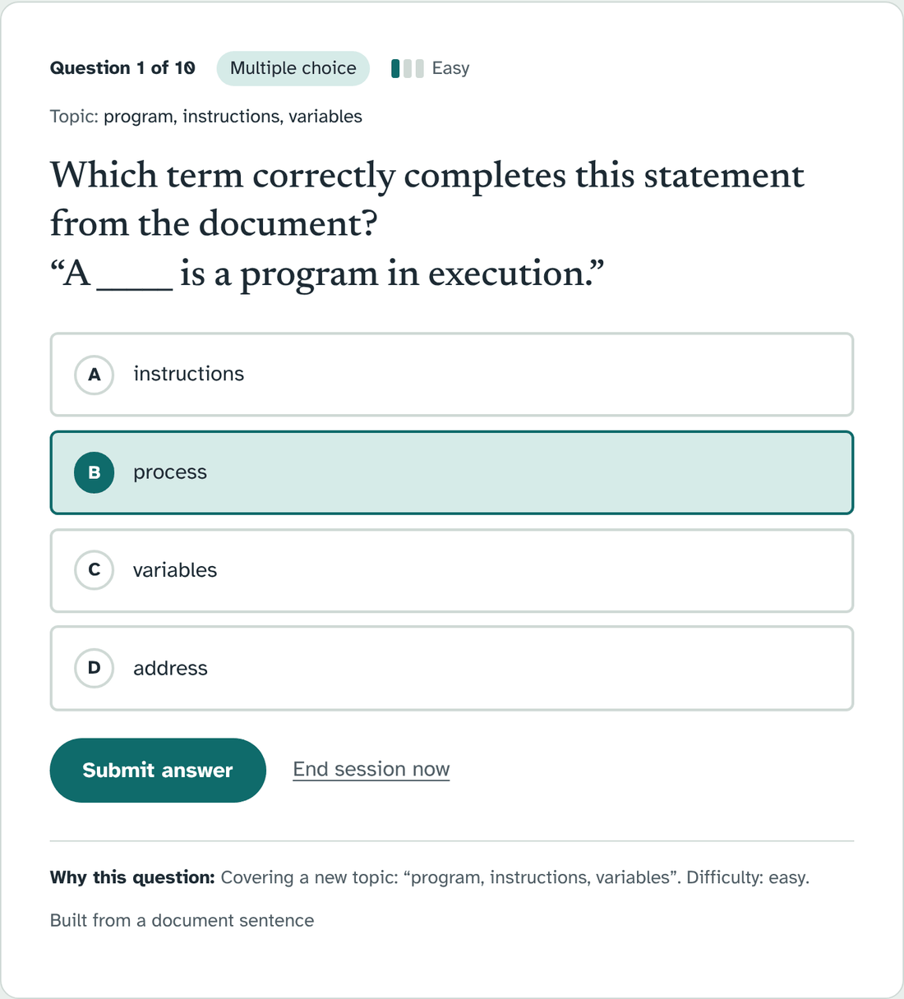
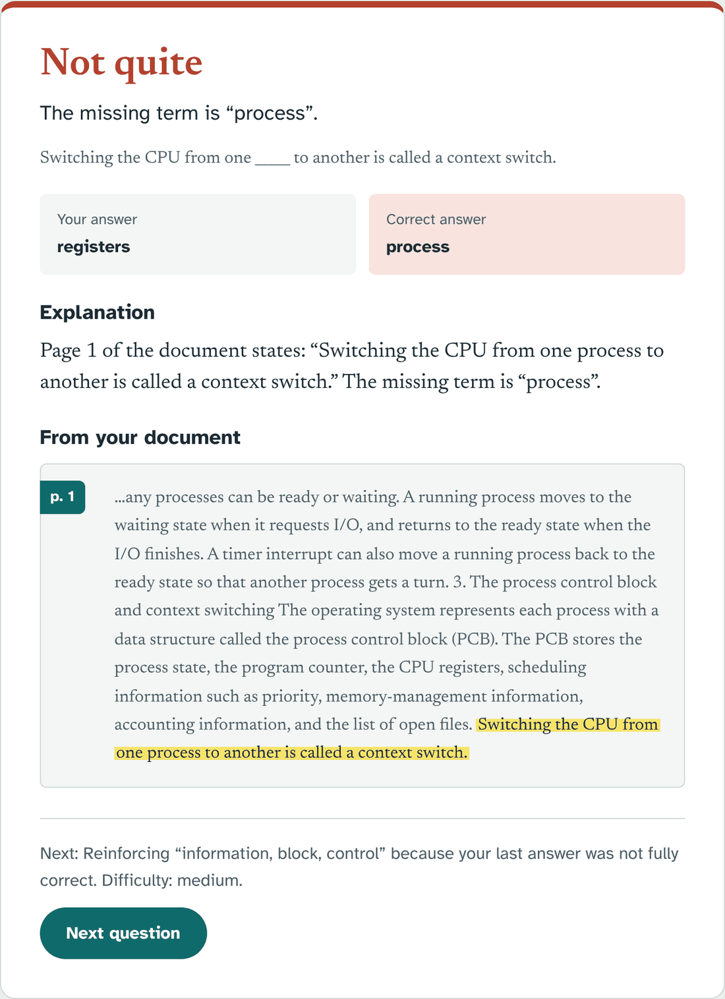
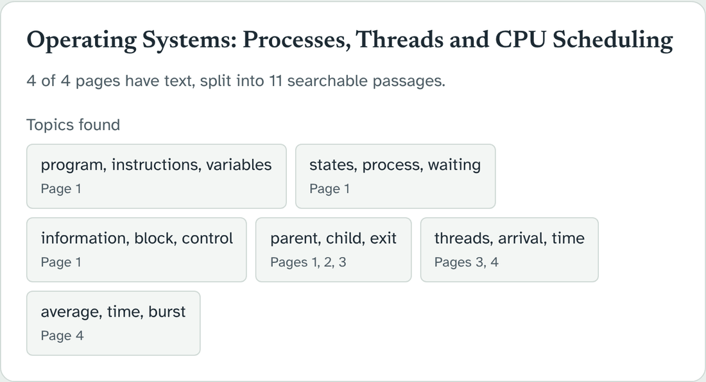
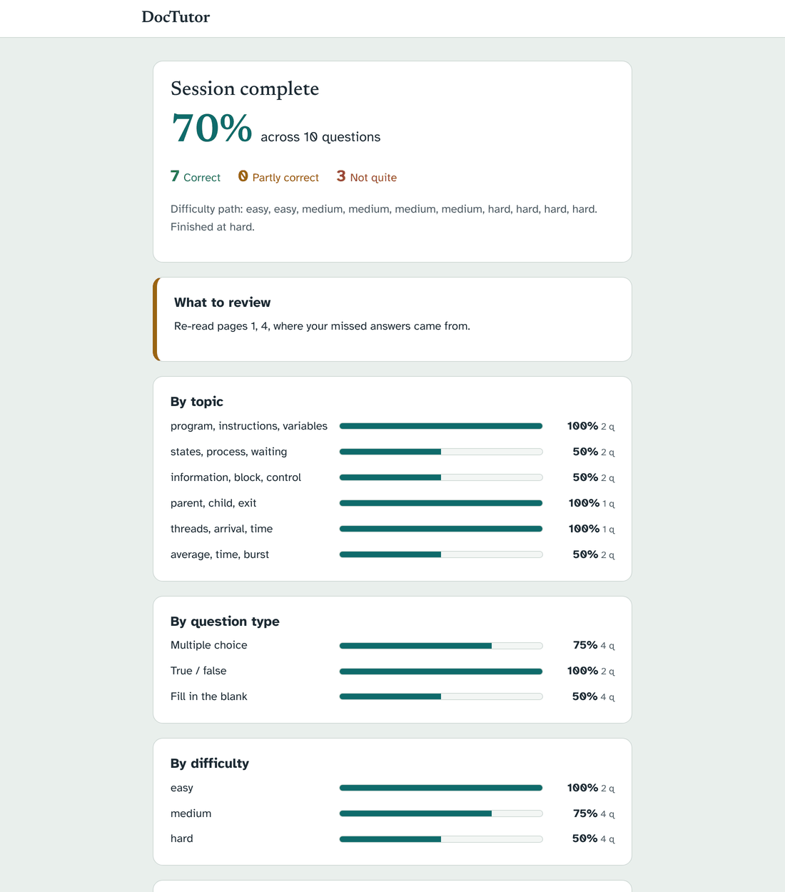
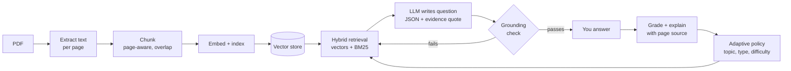

# DocTutor

**Turn any PDF into an adaptive tutor.** Upload lecture notes or a textbook chapter and DocTutor quizzes you one question at a time, grades your answer against the document, and shows you the exact page and sentence the answer comes from. Get things right and it gets harder; get them wrong and it circles back.

Every question is built from passages *retrieved* from your PDF, never from the model's general knowledge. That makes it a genuine RAG pipeline, not a chatbot wrapped around a file.

<table>
  <tr>
    <td width="50%"></td>
    <td width="50%"></td>
  </tr>
  <tr>
    <td align="center"><sub>One question at a time, with the reason it was chosen</sub></td>
    <td align="center"><sub>Feedback cites the page and highlights the sentence</sub></td>
  </tr>
</table>

## Why it's different

- 📄 **Grounded, not guessed.** Questions, answers and explanations come only from retrieved passages. Each AI-written question must quote its evidence, and drafts whose quote isn't in the document are rejected and regenerated.
- 🎯 **Adaptive by clear rules.** Difficulty rises after strong answers and drops after weak ones. Missed concepts come back in a new form, and every question says *why* it was picked.
- ✍️ **Six question types.** Multiple choice, true/false, fill in the blank, short answer, conceptual, and calculation (offered only where the text has numbers).
- 🧠 **Semantic grading.** Free-form answers are marked correct, partly correct or incorrect, with what you got right, missed or got wrong.
- 🔌 **Bring any model.** Google Gemini (free tier), a local model through Ollama, any OpenAI-compatible API, or no AI at all.
- ⚡ **No waiting between questions.** The next question is prepared while you read the feedback, and an overloaded model automatically falls back to a backup.

<table>
  <tr>
    <td width="50%"></td>
    <td width="50%"></td>
  </tr>
  <tr>
    <td align="center"><sub>Topics are discovered automatically after upload</sub></td>
    <td align="center"><sub>The summary shows weak topics and which pages to re-read</sub></td>
  </tr>
</table>

<sub>Screenshots use the bundled sample, <a href="samples/os-processes-and-scheduling.pdf">samples/os-processes-and-scheduling.pdf</a>, in the built-in no-AI mode. With Gemini or Ollama connected, the app also writes short-answer, conceptual and calculation questions.</sub>

## Quick start

You need Python 3.11+.

```bash
cd backend
python -m venv .venv
.venv\Scripts\Activate.ps1        # Windows PowerShell  (macOS/Linux: source .venv/bin/activate)
pip install -r requirements.txt
cp ../.env.example ../.env         # Windows: Copy-Item ..\.env.example ..\.env
python -m uvicorn app.main:create_app --factory --port 8000
```

Open **http://localhost:8000** and upload `samples/os-processes-and-scheduling.pdf`.

### Choose a model (in `.env`)

| Option | Settings | Notes |
|---|---|---|
| **Gemini** (free, recommended) | `LLM_PROVIDER=gemini`<br>`LLM_MODEL=gemini-3.5-flash`<br>`LLM_API_KEY=…`<br>`LLM_FALLBACK_MODELS=gemini-flash-lite-latest` | Get a key at [aistudio.google.com](https://aistudio.google.com). On the free tier Google may use your content to improve its products, so avoid confidential documents. |
| **Ollama** (fully local) | `LLM_PROVIDER=ollama`<br>`LLM_MODEL=qwen3:8b` | Install [Ollama](https://ollama.com), then `ollama pull qwen3:8b`. Needs about 8 GB of free memory. |
| **OpenAI-compatible** | `LLM_PROVIDER=openai_compatible`<br>`LLM_BASE_URL=…/v1`<br>`LLM_MODEL=…` | OpenAI, Groq, LM Studio, vLLM, llama.cpp server. |
| **No AI** | `LLM_PROVIDER=none` | Builds fill-in-the-blank, multiple-choice and true/false questions straight from document sentences. |

Your `.env` is git-ignored, so keys never get committed. Every other setting (chunk size, retrieval depth, adaptivity thresholds, upload limits) is listed with its default in [`.env.example`](.env.example).

## How it works



<details>
<summary><b>The RAG pipeline in detail</b></summary>

1. **Ingest.** The upload is size-capped and checked for a real PDF header. Text is extracted page by page; blank or image-only pages are skipped and reported. Files are stored by content hash, so re-uploading the same PDF reuses its index.
2. **Chunk.** Each page is split at sentence and bullet boundaries into ~900-character chunks with ~150 characters of overlap. Chunks never cross pages and keep their document id, page number and chunk id.
3. **Embed and cluster.** Chunks are embedded and stored in a persistent vector index. Seeded k-means groups them into topics labelled by their most distinctive keywords.
4. **Retrieve.** The adaptive policy picks a topic; a passage from it is embedded as the query; the top `k × 3` vector matches are reranked by `0.7 · cosine + 0.3 · BM25`. Only the best few chunks, capped at 6,000 characters, go to the model.
5. **Generate and validate.** The model returns JSON with the question, answer, explanation, a verbatim evidence quote and the chunk ids it used. A draft is rejected if the quote isn't in the retrieved text, a multiple-choice answer doesn't match exactly one option, or the question repeats an earlier one. Rejected drafts are retried with another passage, and if nothing works the app says so rather than inventing a question.
</details>

<details>
<summary><b>Grading and adaptation</b></summary>

**Grading.** Multiple choice and true/false are checked exactly (option letters accepted). Fill-in-the-blank tolerates casing and small typos, and gives partial credit for part of a multi-word term. Free-form answers are graded by the model against the reference answer, key points and document evidence; if the model is unavailable, a key-point coverage check is used instead.

**Difficulty.** After at least two answers at a level, the last three are averaged (correct = 1, partly = 0.5, wrong = 0): ≥ 80% moves up, ≤ 40% moves down.

**Topics.** In priority order: reinforce the topic you just missed (at most twice in a row); revisit a weak topic (mastery < 50%) you haven't seen recently; otherwise cover the least-practised topic, skipping ones you've mastered.

**Question type.** Each difficulty has a pool (easy favours recognition, hard favours conceptual and calculation). The least recently used type in the pool is chosen, and reinforcement prefers multiple choice or true/false.
</details>

<details>
<summary><b>Project structure</b></summary>

```
backend/app/
  ingestion/      PDF validation, extraction, chunking, pipeline
  embeddings/     hashing (built-in), Ollama, OpenAI-compatible, sentence-transformers
  vectorstore/    VectorStore interface + persistent NumPy store
  retrieval/      hybrid retriever, BM25, topic clustering
  llm/            Gemini, Ollama, OpenAI-compatible providers + validated JSON output
  questions/      prompts, LLM and extractive engines, grounding validator
  evaluation/     rule-based and LLM graders
  adaptive/       difficulty / topic / type policy
  sessions/       session state, persistence, summary
  api/            FastAPI routes and schemas
frontend/         HTML, CSS and ES modules (no build step)
samples/          demo PDF
```

Every replaceable part (text extractor, embedder, vector store, LLM, question engine) sits behind a small interface and is wired up in `backend/app/container.py` from environment variables.
</details>

## Tech stack

Python · FastAPI · Pydantic · pypdf · NumPy · httpx · vanilla JavaScript · pytest · Node test runner with jsdom

## Tests

```bash
cd backend && python -m pip install -r requirements-dev.txt && python -m pytest   # 107 tests
cd frontend && npm install && npm test                                            # 15 tests
```

The backend suite uses a fake LLM that only sees the prompt and answers from the context blocks inside it, so the real prompt → JSON → validation → grading path is tested without calling a model.

## Limitations

- No OCR yet: scanned pages without a text layer are skipped.
- The default `hash` embedder matches words, not meaning. Set `EMBEDDING_PROVIDER=ollama` with `nomic-embed-text` for semantic retrieval.
- Question quality depends on the model. Free-tier Gemini can be busy at peak times (backup models help).
- Single-user design: sessions are stored as local JSON files.

## Roadmap

- OCR for scanned PDFs
- Spaced repetition across sessions
- Multi-document study sets
